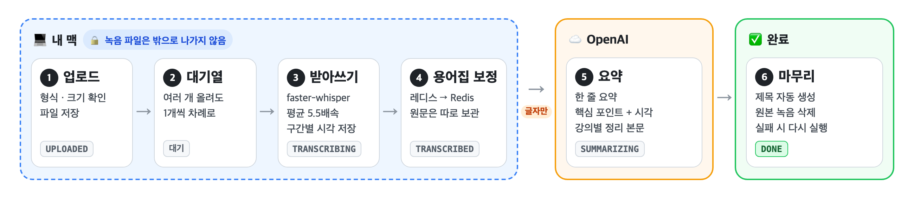
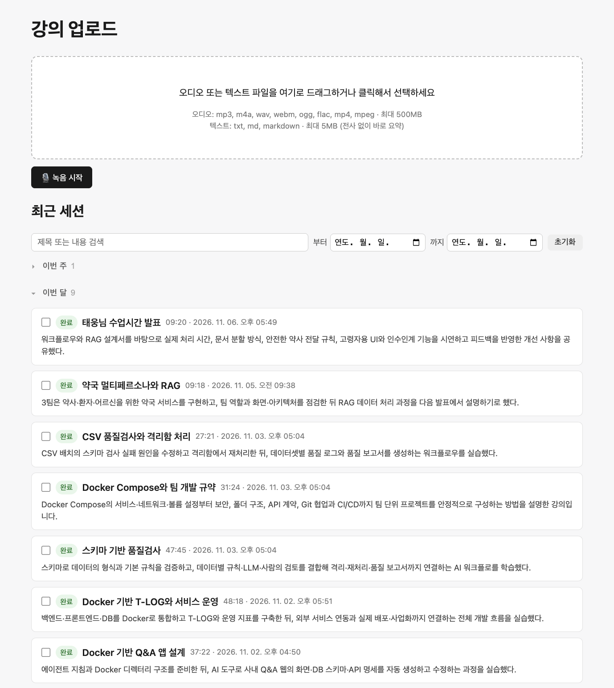
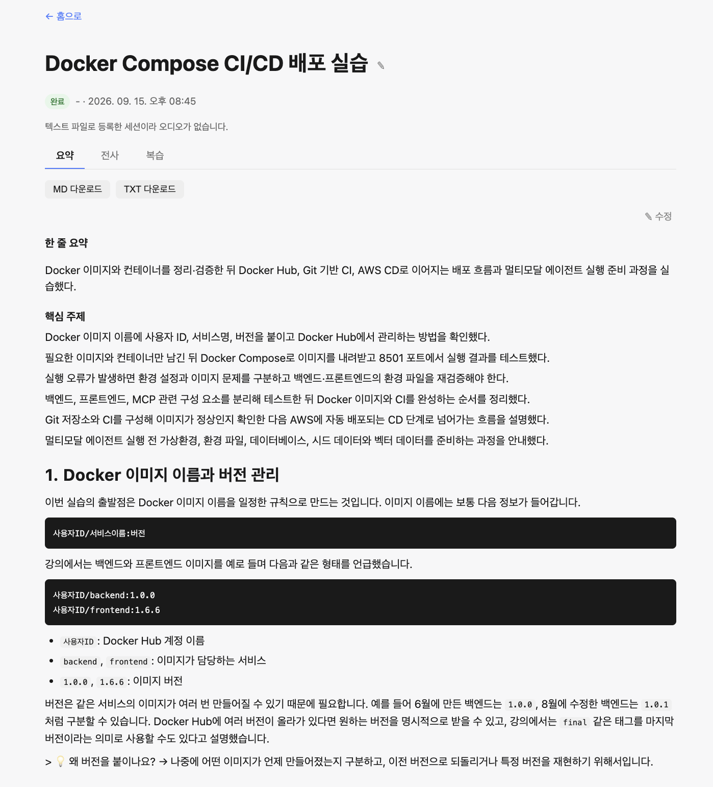
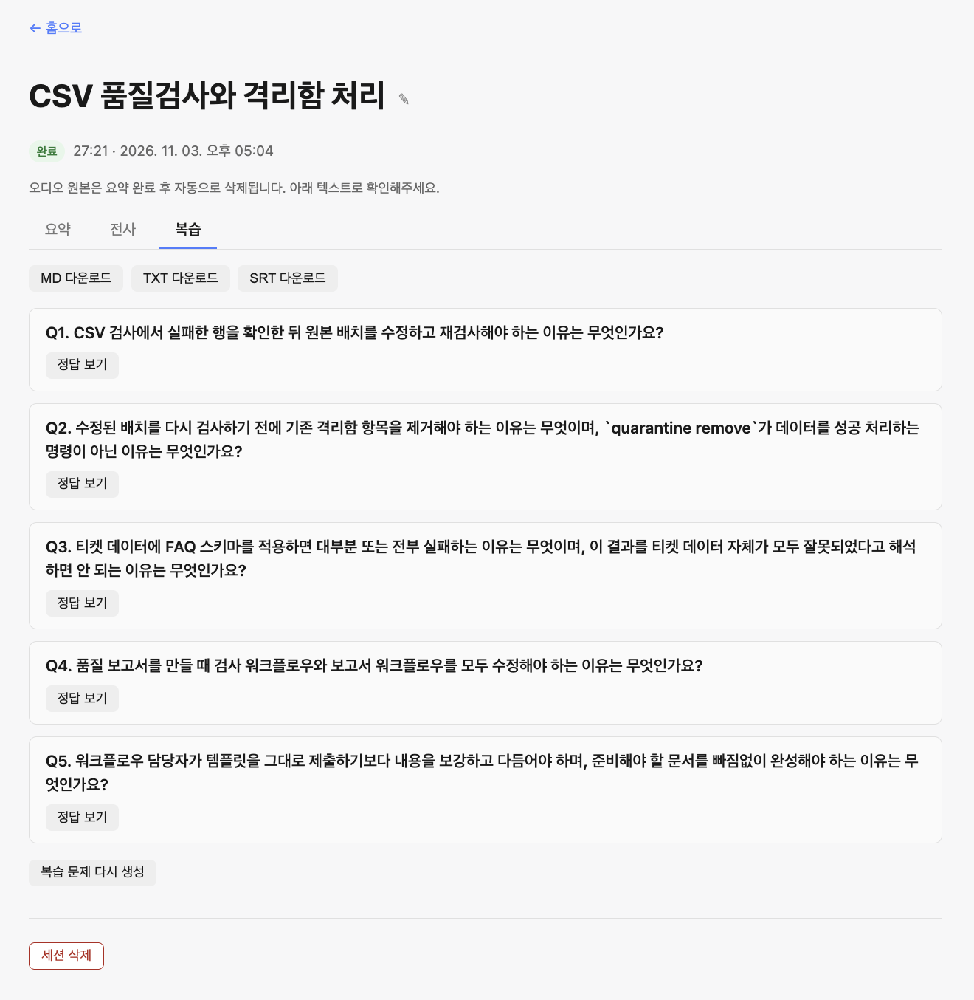

# lecture-notes

> 수업 녹음을 올리면 **내 맥에서** 받아쓰고, 요약과 복습 문제까지 만들어 주는 개인 학습 도구입니다.  
> 개인 사용 목적으로 만든 첫 풀스택 프로젝트 · AI 코딩 도구(Claude Code)와 함께 만듦 · 2026.08 ~ 운영 중

> **문제** · AI 캠퍼스에서 하루 8시간 수업을 들으며, 놓친 내용을 확인하고 복습할 방법이 필요했음  
> **판단** · 녹음(개인정보)은 내 맥 밖으로 내보내지 않고, 요약만 클라우드 AI에 맡김  
> **결과** · 3개월간 강의 **259개 · 녹음 162시간**을 실제로 처리, 받아쓰기 평균 **실제 시간의 5.5배 속도**  
> **한계** · 사용자는 나 혼자 · 받아쓰기 정확도는 아직 숫자로 재지 못함

 

## 기술

| 구분 | 사용 |
| --- | --- |
| 백엔드 | Python · FastAPI · SQLAlchemy · Alembic · SQLite |
| 받아쓰기 | faster-whisper `large-v3-turbo` (내 맥, 오프라인) |
| 요약 · 문제 | OpenAI Responses API (structured outputs) |
| 프론트 | TypeScript · Vite (React 등을 쓰지 않음 · 화면 4개) |
| 테스트 | pytest · Vitest · Playwright |
| 운영 | macOS launchd (자동 시작 · 재시작) · 매일 DB 백업 · Tailscale (내 기기에서만 원격 접속) |

 

## 흐름 한눈에

> 녹음은 내 맥에서만 받아쓰고, 요약할 때는 받아쓴 **글자만** OpenAI로 보냅니다. 텍스트 파일을 올리면 ②~③(받아쓰기)을 건너뛰고 용어집 보정 후 바로 요약합니다.

 

## 화면

<table>
<tr>
<th width="33%">① 홈 — 올리기 · 목록</th>
<th width="33%">② 요약 — 정리 노트</th>
<th width="33%">③ 복습 — 복습 문제</th>
</tr>
<tr>
<td valign="top"></td>
<td valign="top"></td>
<td valign="top"></td>
</tr>
<tr>
<td valign="top">파일을 끌어다 놓거나 <b>바로 녹음</b>. 강의마다 AI가 붙인 제목 · 녹음 길이 · 한 줄 요약이 보이고, 검색 · 날짜 필터 · 여러 개 내보내기 지원</td>
<td valign="top"><b>한 줄 요약 → 핵심 주제 → 정리 본문</b>. 본문은 강의에 맞게 AI가 구성하고 직접 수정 가능. 전사 탭에서 원문을 시각과 함께 확인</td>
<td valign="top">강의 내용으로 만든 <b>복습 문제 5개</b>. 스스로 답해 본 뒤 정답 보기로 확인하고, 필요하면 다시 생성</td>
</tr>
</table>

> 이미지를 누르면 크게 볼 수 있습니다.

 

## 실제 사용 기록

앱 DB에 쌓인 기록을 그대로 집계한 숫자입니다. (2026-08-22 ~ 11-10)

| 항목 | 값 |
| --- | --- |
| 처리한 강의 | 259개 (녹음 234 · 텍스트 25) |
| 녹음 총량 | 162시간 (평균 42분 · 최장 94분) |
| 받아쓰기 속도 | 평균 실제 시간의 5.5배 → 60분 강의 ≈ 11분 |
| 최종 완료 | 259개 모두 완료 (실패한 건은 다시 실행해 복구) |
| 테스트 | 백엔드 테스트 440개 · 프론트 단위 테스트 + E2E(업로드 → 요약 → 내보내기) |

 

## 직접 써 보면서 내린 판단

만들기 전에 쓴 [기획서](docs/requirements/stt-transcription.md)와 지금 앱을 비교하면, **써 보면서 계획을 바꾼 지점**이 보입니다. 이 프로젝트의 핵심은 기능 목록보다 이 판단들입니다.

| 처음 계획 (기획서) | 써 보니 생긴 문제 | 판단 | 결과 |
| --- | --- | --- | --- |
| 요약도 내 맥(로컬 AI)에서 · **월 비용 0원**, 유료 API는 쓰지 않음 | 메모리 24GB가 부족해 느려지고, 요약 형식 오류로 두 번 연속 실패 | 받아쓰기는 내 맥에 두고 **요약만** OpenAI로 옮김. 응답 형식을 서버가 강제하는 방식(structured outputs) 사용 | 형식 오류가 구조적으로 사라짐. 녹음은 계속 밖으로 안 나감 |
| "동시에 처리할 강의는 1건"이라고 **가정** | 강의 9개를 한꺼번에 올리자 4시간 동안 진행률이 20%에서 멈춤 (전체 속도 0.3배, 실측) | 업로드는 바로 받되, 받아쓰기는 **한 번에 1개씩** 줄 세우기 | 멈춘 8개를 같은 방법으로 모두 복구 |
| 긴 강의는 잘게 나눠 요약 (로컬 AI 기준) | 요약이 1~2분씩 걸려 조사 → OpenAI에도 필요 없이 2~3번 나눠 보내고 있었음 | 모델이 한 번에 받을 수 있는 길이를 공식 문서로 확인하고, AI 종류별로 나누는 크기를 따로 설정 | 긴 강의도 한 번에 요약 |
| 요약을 **고정 6칸**으로 (개념 · 코드 · 과제 · 키워드 등) | 강의마다 구성이 다른데 칸이 고정돼 '용어: 한 줄 정의'처럼 뭉뚱그린 요약이 됨 | 한 줄 요약 · 핵심 포인트만 고정하고, 본문은 강의에 맞게 **자유 형식** | 강의 흐름대로 읽히는 정리 노트 |
| 6칸 중 하나였던 "복습 키워드" | 실제로 거의 안 봄 | 만든 기능이라도 **제거** | 화면이 단순해짐 |
| 원본 녹음 보관 (정리 방법은 나중에 검토) | 오디오 다시 듣기를 거의 안 씀 | 요약이 끝나면 원본 녹음 자동 삭제 (설정으로 끌 수 있음) | 디스크 사용량 · 개인정보 부담 감소 |

 

## 목표 vs 결과

기획서에 숫자로 정해 둔 목표와 실제 결과입니다.

| 목표 (기획서) | 결과 |
| --- | --- |
| 60분 강의를 **20분 안에** 처리 | ✅ 받아쓰기 평균 약 11분(실측) + 요약 1~2분 |
| 월 운영 비용 **0원** | ❌ 요약을 OpenAI로 옮기며 **의도적으로 포기** (안정성 · 품질 우선) |
| 기술 용어 정확 표기 **90% 이상** | ⏸ 아직 측정 못 함 (아래 한계 참고) |

 

## 한계

- 사용자가 나 한 명이라 동시 사용자 · 배포 환경은 다루지 않았습니다.
- 받아쓰기 정확도(틀린 글자 비율)는 아직 정답 데이터를 만들지 않아 숫자로 재지 못했습니다.

 

## 폴더 구조

| 폴더 | 내용 |
| --- | --- |
| `backend/app` | API · 받아쓰기 · 요약 파이프라인 · 용어집 |
| `backend/tests` | 단위 · 통합 테스트 |
| `frontend/src` | 화면 (업로드 · 목록 · 상세 · 검색 · 퀴즈) |
| `frontend/e2e` | 브라우저 E2E 테스트 |
| `docs/requirements` | 만들기 전에 쓴 기획서 (AI 기획 에이전트와 함께 작성, 직접 검토 · 승인) |
